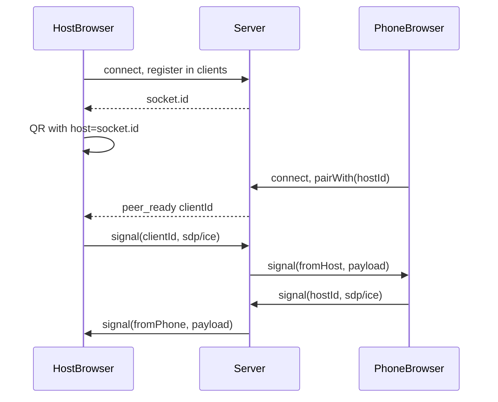

# Socket.IO + SimplePeer core rebuild (teacher-aligned)

## Current vs target

| Layer     | Today ([server.js](/Users/cezar/Desktop/webrtc/server.js), [public/app.js](/Users/cezar/Desktop/webrtc/public/app.js)) | Target (teacher + your UX)                                                                                                                                                       |
| --------- | ---------------------------------------------------------------------------------------------------------------------- | -------------------------------------------------------------------------------------------------------------------------------------------------------------------------------- |
| Signaling | `ws` + JSON messages; `rooms` Map with **host/client slots**, `join` / `leave` / relay `offer`/`answer`/`candidate`    | **Socket.IO**; in-memory `**clients`** map; relay `**signal`** to a target **socket id** via `io.to(peerId).emit(...)` (same idea as teacher’s [index.js snippet](user message)) |
| WebRTC    | Manual `RTCPeerConnection`, `createDataChannel('control')`, offer/answer + ICE queue                                   | **SimplePeer** (data-only, no `getUserMedia`), `**peer.send` / `peer.on('data')`** for JSON pointer messages (theremin-style data path)                                          |
| UX        | One page: host gets random `room` in URL, QR → phone opens `?room=…&role=client`                                       | **Unchanged visually**: same [public/index.html](/Users/cezar/Desktop/webrtc/public/index.html) panels, status, retry, `/ip` + QR behavior                                       |

Important nuance: the teacher’s classroom demo uses a **peer dropdown** (sender picks `peerId`). Your product flow is **QR pairing** without a visible list. That does **not** require bringing back server-side “rooms” with host/client slots. It only needs a **thin pairing step** on top of the teacher relay:

- After Socket.IO `connect`, the **host** has a stable `**socket.id`** for that session.
- Encode that id in the QR link (reuse the existing `room` query param as **“target host socket id”** for minimal URL/UI churn, or rename to `host` in code only—your choice; behavior stays “scan to join”).
- When the **phone** connects, it emits something like `**pairWith(hostSocketId)`** (custom event). Server checks `clients[hostSocketId]`, then notifies **host** with `**{ clientId: phoneSocketId }`** (and optionally confirms to phone). Host then acts as the teacher’s **sender**: `new SimplePeer({ initiator: true, … })` and `socket.emit('signal', clientId, data)`. Phone acts as **receiver**: on first `offer`, create `new SimplePeer({ initiator: false, … })` and `peer.signal(signal)` for subsequent messages—same lifecycle idea as the teacher’s receiver, without the buggy double-call pattern in the pasted snippet.

This keeps the **teacher-approved** core (`**clients` + `io.to(peerId)` signaling**), avoids the old **two-slot room** abstraction, and preserves **QR-driven** flow.

## Phase 1 — Server and dependencies

1. **Dependencies** ([package.json](/Users/cezar/Desktop/webrtc/package.json)): add `**socket.io`** (and optionally `**dotenv`** if you mirror theremin). Remove `**ws**` once nothing uses it.
2. **Server entry** ([server.js](/Users/cezar/Desktop/webrtc/server.js)):
  - Keep Express static + `**/ip`** + `**/qr`** (or drop `/qr` in phase 2 if you switch to client-side QR like theremin—see below).
  - Create HTTP or HTTPS server like [theremin/server.js](/Users/cezar/Desktop/webrtc/theremin/server.js): if `localhost.key` / `localhost.crt` exist and `NODE_ENV=development`, use HTTPS so phones on the LAN get a **secure context** when you need it later.
  - Attach **Socket.IO** to that server.
  - Implement teacher-style `**clients`** bookkeeping and `**disconnect`** cleanup with `**io.emit('clients', clients)**` if you want debugging or future UI; pairing events can be separate.
  - Implement `**signal**`: `(peerId, signal)` → `io.to(peerId).emit('signal', signal, socket.id)` (use a **clear, documented** payload shape; the triple-argument order in the pasted HTML is easy to get wrong).
  - Add `**pairWith(hostId)`** (or similar): validate host exists, optional “one client per host” guard, then `io.to(hostId).emit('peer_ready', { clientId: socket.id })`.
3. **Client script tags** ([public/index.html](/Users/cezar/Desktop/webrtc/public/index.html)): load `**/socket.io/socket.io.js`** and **simple-peer** (same CDN as teacher/theremin) before your app script.

## Phase 2 — [public/app.js](/Users/cezar/Desktop/webrtc/public/app.js) (same UI, new under the hood)

1. **Remove** `WebSocket`, manual `RTCPeerConnection`, `pendingCandidates`, `createOffer`/`createAnswer`/`addIceCandidate` paths.
2. **Signaling**: `const socket = io()` (or `io('/')`), handlers for `connect`, `peer_ready`, `signal`, `disconnect` / server errors. Replace `wsSend({ type: 'join', … })` with `**pairWith`** on the phone and “wait for peer” on the host.
3. **WebRTC**:
  - **Host**: on `peer_ready`, create `**SimplePeer({ initiator: true, config: { iceServers: … } })`** (no `stream`—data only). On `peer.on('signal', data => socket.emit('signal', clientId, data))`. On `**peer.on('data')`**, parse JSON and keep today’s `**pointer**` handling for the laser.
  - **Phone**: on incoming `**signal`**, lazily instantiate `**SimplePeer({ initiator: false, … })`** if needed (same pattern as [theremin/public/desktop.js](/Users/cezar/Desktop/webrtc/theremin/public/desktop.js) lines 51–93), then `**peer.signal(signal)**`. Replace touchpad `**dataChannel.send**` with `**peer.send(JSON.stringify(...))**` when `peer.connected` (or use simple-peer’s connect event to match theremin).
4. **URL / QR**: After host `connect`, set query to include **host socket id** (reuse `room` param to avoid changing copy/UI, or document the semantic change). Reuse `**getJoinUrl()`** + `**/qr`** or adopt **qrcodejs** in-page like [theremin/public/index.html](/Users/cezar/Desktop/webrtc/theremin/public/index.html) to drop the extra HTTP round-trip—optional polish.
5. **Lifecycle**: Map today’s `**peer_left`** behavior to Socket.IO: when peer disconnects, server notifies the other side; destroy SimplePeer, show same status/retry/QR as now.
6. **Retry button**: reload or reset socket + peer cleanly (destroy peer, re-`pair` on phone).

## Theremin techniques to borrow (without changing the visible flow)

- **Optional HTTPS + dotenv** from [theremin/server.js](/Users/cezar/Desktop/webrtc/theremin/server.js).
- **Lazy SimplePeer** construction on the answering side (desktop pattern in theremin) applied to the **phone** in your app (since the **host** is initiator—opposite initiator role vs theremin mobile, but same “create peer when negotiation starts” idea).
- **Binary JSON over `peer.send` / `peer.on('data')`** instead of maintaining a raw data channel reference.
- (Optional) **Client-side QR** to align with theremin and simplify the server.

## Out of scope / follow-ups

- Teacher’s samples use **video/audio**; your app only needs a **data** channel—SimplePeer still fits; do **not** add `getUserMedia` unless you want it for parity with the literal school demo.
- [public/app.js](/Users/cezar/Desktop/webrtc/public/app.js) references `**cat.png`** while the repo has `**cat.svg`**—fix separately if the image is broken.
- Update [README.md](/Users/cezar/Desktop/webrtc/README.md) only if you want docs to match the new stack (you did not request doc edits).

## Verification

- Two browsers: host opens `/`, phone opens QR link; status strings and panels match today; laser + cat move from phone touchpad.
- Disconnect phone: host returns to waiting/QR; reconnect works.
- Optional: phone on LAN with HTTPS dev certs if you enable theremin-style TLS.

